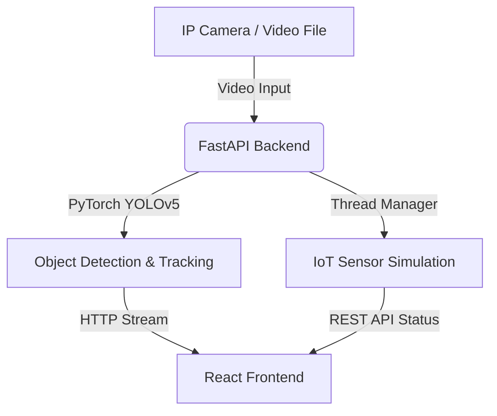

# 02 · 现状代码库分析（fork 自 Video-analytics-pro）

> 调研时间：2026-11-24，基于 main 分支（`a5354bf`）。
> 本文档所有"全文复制"部分与仓库当时内容逐字一致。

---

## 0. 覆盖范围与局限（重要）

本次调研处于只读计划模式，目录清单无法用 `ls`/`git ls-files` 枚举（Bash 受限），文件列表由 **README 声明 + import 语句 + 路径猜测验证** 得出，**不保证穷尽**。已确认存在的路径：

> **后记（文档整理收尾时补充）**：此前卡死的后台探索 agent 在限额耗尽前跑通了部分只读命令，其最后结果交叉印证了三点——① `git log` 全历史仅 4 条提交，**仓库从未存在过 Node.js 后端**；② vendored `yolov5/` 为 **v6.x 快照**（requirements.txt / Dockerfile / pre-commit 引脚 / README 特征一致，精确 tag 未最终钉定）；③ 前端对后端的依赖仅为 README 所述的 FastAPI 契约。该 agent 报告非逐字来源，仅作交叉印证，实际代码一律以本文件 §6 快照为准。

```
SmartCCTV/
├── README.md                     ✅ 已读（全文见 §3.1）
├── requirements.txt              ✅ 已读（全文见 §3.2，位于仓库根目录）
├── backend/
│   ├── main.py                   ✅ 已读（全文见 §3.3）
│   ├── vision_engine.py          ✅ 已读（全文见 §3.4）
│   ├── sensor_manager.py         ✅ 已读（全文见 §3.5）
│   ├── shared_state.py           ✅ 已读（全文见 §3.6）
│   ├── dcp.py                    ⚠️ 未读。存在依据：vision_engine.py:11 `from .dcp import apply_dcp_stream`（暗通道先验去雾，流式版）
│   ├── graphs.py                 ⚠️ 未读。存在依据：vision_engine.py:44 `from graphs import bbox_rel, draw_boxes`（DeepSORT 画框辅助）
│   ├── yolov5/                   ⚠️ vendored 完整 YOLOv5 仓库（含 yolov5s.pt 权重，main.py:32 引用路径 `backend/yolov5/yolov5s.pt`）
│   ├── deep_sort_pytorch/        ⚠️ vendored DeepSORT（含 configs/deep_sort.yaml 与 ReID ckpt，vision_engine.py:71-75 引用）
│   └── uploads/                  运行时目录（main.py:12-13 创建，存放上传视频）
├── frontend/                     React/Vite 前端
│   ├── package.json              ✅ 已读（全文见 §3.7）
│   ├── vite.config.js            ✅ 已读（全文见 §3.8）
│   └── src/
│       ├── App.jsx               ✅ 已读（全文见 §3.9）
│       ├── index.css             ⚠️ 未读（App.jsx:11 引用，Tailwind 入口）
│       ├── main.jsx              ⚠️ 未读（Vite 惯例入口，未验证）
│       └── components/
│           ├── VideoFeed.jsx     ✅ 已读（全文见 §3.10）
│           ├── Header.jsx        ⚠️ 未读（App.jsx:7 引用）
│           ├── Sidebar.jsx       ⚠️ 未读（App.jsx:8 引用）
│           └── AnalyticsCharts.jsx ⚠️ 未读（App.jsx:9 引用，recharts 图表）
└── screenshots/                  ⚠️ 未读（README 引用 ss1.png/video1.png/ss2.png/ss6.png/iot_setup.png）
```

未读文件（dcp.py、graphs.py、Header/Sidebar/AnalyticsCharts、index.css、main.jsx、vendored 两个目录的内部）**内容未经验证**，日后改动前应先自行阅读。

## 1. 一句话结论

这是一个**演示级（demo）项目**：后端约 300 行 Python（单摄像头、全局类变量状态、无鉴权、无持久化），前端单页仪表盘。它验证了 "FastAPI + MJPEG + YOLOv5 + DeepSORT + React" 这条技术路线能跑通，但**不具备多摄像头、生产化基础**。改造策略建议：**后端按生产标准重写，前端保留技术栈（React 19 + Vite 8 + Tailwind 4）重写页面，vendored 的 yolov5 与 deep_sort_pytorch 整体弃用**。

## 2. 后端逐文件解读

### 2.1 `backend/main.py`（78 行）

- FastAPI 应用，**CORS 全开**（`allow_origins=["*"]`）。
- 仅 4 个接口：
  - `GET /status` — 返回 `SmokeStatus` 全局类上的指标（烟雾布尔/等级、human_count、fps、CPU/内存占用等）；前端每 1 秒 axios 轮询。
  - `POST /configure` — 运行时改全局变量（source 切换、conf_thres、is_tracking 开关）。
  - `POST /upload` — 上传视频文件存到 `backend/uploads/`，切换 source。
  - `GET /video_feed` — **MJPEG over HTTP**（`multipart/x-mixed-replace; boundary=frame`），由 `VisionEngine.get_video_stream()` 生成器产出。
- startup 事件里：加载 `backend/yolov5/yolov5s.pt` 权重构建 `VisionEngine`，并启动"IoT 模拟"守护线程。
- 注意 `engine` 是模块级全局，且 `video_feed` 为同步 def（在线程池里跑阻塞生成器）。

### 2.2 `backend/vision_engine.py`（165 行）

- 核心循环 `get_video_stream(source)`：`cv2.VideoCapture` 读帧 →（视频文件或"检测到烟雾"时执行 DCP 去雾）→（is_tracking 开启时）YOLOv5 letterbox 推理 + NMS → 把 person 类（cls==0）计数、喂 DeepSORT → 画框 → `cv2.imencode('.jpg')` 逐帧 yield MJPEG 分节。
- 含两处针对新版 PyTorch 的补丁：`torch.load` 强制 `weights_only=False` 的 monkeypatch；`torch.serialization.add_safe_globals`。
- `SmokeStatus`（shared_state）承担了"前后端共享内存"角色：帧率、人数、CPU/内存、当前 source 等。
- 每帧全流程同步执行，单路即全速，无多路概念。

### 2.3 `backend/sensor_manager.py`（15 行）

- "IoT" 实为**模拟器**：守护线程每 30 秒把 `SmokeStatus.is_smoke_detected` 布尔翻转一次并打印日志。README 所称 "Daemon Thread Sensor Manager / IoT Sensor Simulation" 即此。
- 与真实硬件无任何交互。（git 提交 `8be3804` "integrate IoT code and hardware layout" 带来的是 README 里的 iot_setup.png 截图，代码侧即这个模拟器。）

### 2.4 `backend/shared_state.py`（23 行）

- 一个纯类属性容器 `SmokeStatus`：烟雾状态、人数、fps、min/max fps、CPU/内存/GPU 内存占用、conf_thres、is_tracking、current_source(默认 0=摄像头)。无锁、无持久化。

### 2.5 根 `requirements.txt`

- 实为 **YOLOv5 官方 requirements 的拷贝**（matplotlib/torch/torchvision/tensorboard/pandas/seaborn/thop 等），再混入 `streamlit`、`psutil`。
- **没有** fastapi/uvicorn（README 让用户手动 `pip install -r requirements.txt fastapi uvicorn`）；版本全部无上界，属演示项目写法。

### 2.6 鉴权 / 持久化 / 多路

- **无任何鉴权**（CORS 全开 + 无 token）。
- **无数据库**，一切状态在内存。
- **单摄像头**：`SmokeStatus.current_source` 全局单值，切换即热替换。
- 录像/事件/人脸：**均不存在**。

## 3. 前端解读

- `package.json`：React 19 + Vite 8 + Tailwind 4（`@tailwindcss/vite` 插件）+ framer-motion 12 + recharts 3 + lucide-react + axios；devDependencies 为 eslint 套件。无路由库、无状态库、无 socket 库——与"MJPEG `` + 轮询"的后端形态一致。
- `vite.config.js`：仅注册 react + tailwind 插件，**无代理配置**，因此前端把后端地址硬编码为 `http://localhost:8000`（App.jsx、VideoFeed.jsx 中可见）。
- `App.jsx`：1 秒轮询 `/status`；布局为左 Sidebar（遥测）+ 右侧 VideoFeed + AnalyticsCharts；`emergency_mode`（smoke_level>90）时全屏红色覆盖动画。
- `VideoFeed.jsx`：`` 直接吃 MJPEG 流；烟雾时边框红光动画与 "Adaptive Vision Active" 覆盖层。
- 未读的 Header/Sidebar/AnalyticsCharts 三个组件从引用关系看分别是顶栏、指标侧栏、recharts 实时图表。

## 4. 复用 vs 弃用结论

| 现有资产 | 处置建议 | 理由 |
|----------|----------|------|
| React+Vite+Tailwind 技术栈与页面骨架思路 | **保留并扩展** | 版本新（19/8/4）、依赖干净；新增登录/人脸库/事件/规则等页面在此栈上写 |
| MJPEG `` 展示方式 + 服务端画框 | **保留** | 对 <10 路内网场景是最简单可靠的方案（对比 WebSocket 二进制/HLS 复杂度） |
| `axios` 1s 轮询 `/status` | 改为 SSE 推送 | 轮询延迟高、无事件语义 |
| 硬编码 `localhost:8000` | 改 vite proxy + 相对路径 | 部署到 cctv.lobn 必需 |
| `backend/` 全部 Python 代码 | **重写**（可参考其 DCP 去雾、系统指标采集思路） | 单路/全局变量/无鉴权/无 DB 的演示结构无法承载多路+人脸+门禁 |
| vendored `backend/yolov5/`、`backend/deep_sort_pytorch/` | **删除**（git rm） | 被 ultralytics(YOLO26+内置 ByteTrack) 完全替代；占用体积大 |
| `backend/dcp.py`（去雾） | 可选保留思路 | 若需要烟雾场景增强再移植；非首期 |
| `requirements.txt`（根） | 删除，被 uv `pyproject.toml` 取代 | 内容本就是 YOLOv5 官方依赖拷贝 |
| `screenshots/` | 删除或移入 docs 存档 | 属上游宣传图 |
| README.md | 重写 | 保留 fork 出处与上游署名 |
| LICENSE | **缺失**（README 声称 MIT 但仓库无 LICENSE 文件） | 若继续公开仓库需补；建议在新 README 注明 fork 自 Video-analytics-pro |

## 5. 上游归属

- README 自述 "A real-time computer vision and IoT analytics platform … FastAPI backend … YOLOv5 & DeepSORT … React + Vite … TailwindCSS"，并声称 MIT License（无对应文件）。
- 保留 fork 关系与上游说明属于基本礼仪，建议写入新 README。

---

## 6. 关键源码全文复制（调研当时逐字快照）

### 6.1 `README.md`（根目录，115 行）

````markdown
# Video Analytics Pro

A real-time computer vision and IoT analytics platform designed for intelligent monitoring, object detection, and hazard detection (such as smoke and fire). The project features a high-performance **FastAPI (Python) backend** integrated with **YOLOv5 & DeepSORT**, alongside a modern, responsive **React + Vite dashboard** styled with TailwindCSS.

---

## 📸 Screenshots


| Dashboard Overview | Live Video Feed |
| :---: | :---: |
|  |  |

| Alert Configurations | Alert Configurations |
| :---: | :---: |
|  |  |

| Hardware & IoT Setup |
| :---: |
|  |

---

## ✨ Features

- **Real-Time Video Analytics**: Process video streams dynamically using YOLOv5 object detection.
- **Multi-Object Tracking**: Integrates DeepSORT to track individual objects (e.g., humans) frame-by-frame.
- **Smoke & Hazard Detection**: Automated threshold calculations and alert triggers when hazardous smoke/fire is detected.
- **Daemon Thread Sensor Manager**: Simulates/manages physical IoT sensor inputs in a concurrent background thread.
- **High-Performance Stream**: Video streaming served over HTTP multipart boundary frames to the frontend client.
- **Modern Dashboard UI**: 
  - Framer Motion micro-animations for interactions.
  - Interactive charts via Recharts visualizing detection trends.
  - Smooth glassmorphism styled panels.

---

## 🛠️ Architecture



---

## 🚀 Setup & Installation

### Backend (Python FastAPI)

1. Navigate to the backend directory:
   ```bash
   cd backend
   ```

2. Create and activate a virtual environment:
   ```bash
   python -m venv .venv
   # On Windows (PowerShell)
   .\.venv\Scripts\Activate.ps1
   # On Linux/macOS
   source .venv/bin/activate
   ```

3. Install the dependencies:
   ```bash
   pip install -r requirements.txt fastapi uvicorn
   ```

4. Start the server:
   ```bash
   uvicorn backend.main:app --reload
   ```
   The backend will be running at `http://127.0.0.1:8000`.

---

### Frontend (React + Vite)

1. Navigate to the frontend directory:
   ```bash
   cd frontend
   ```

2. Install dependencies:
   ```bash
   npm install
   ```

3. Start the development server:
   ```bash
   npm run dev
   ```
   The frontend will be running at `http://localhost:5173`.

---

## 📡 API Endpoints

- `GET /status` - Retrieves current system metrics (smoke level, CPU usage, human count, etc.).
- `POST /configure` - Dynamically updates detection parameters (confidence threshold, source path, tracking toggle).
- `POST /upload` - Uploads a new video file to process.
- `GET /video_feed` - Live MJPEG video stream showing bounding boxes and tracking IDs.

---

## 🛡️ License

This project is licensed under the MIT License - see the LICENSE file for details.
````

### 6.2 `requirements.txt`（根目录）

```text
# pip install -r requirements.txt

# Base ----------------------------------------
matplotlib>=3.2.2
numpy>=1.18.5
opencv-python>=4.1.2
Pillow>=7.1.2
PyYAML>=5.3.1
requests>=2.23.0
scipy>=1.4.1
torch>=1.9.1
torchvision>=0.10.1
tqdm>=4.41.0

# Logging -------------------------------------
tensorboard>=2.4.1

# Plotting ------------------------------------
pandas>=1.1.4
seaborn>=0.11.0

thop 

# Extras -----------
streamlit
psutil
```

### 6.3 `backend/main.py`

```python
from fastapi import FastAPI, File, UploadFile
from fastapi.responses import StreamingResponse
from fastapi.middleware.cors import CORSMiddleware
import shutil
import os

print("[SYSTEM] Main.py is being loaded by Uvicorn...")
from .sensor_manager import start_sensor_thread
from .shared_state import SmokeStatus
from .vision_engine import VisionEngine

UPLOAD_DIR = "backend/uploads"#creates a folder uploads in the backend folder so that if there isa video uploaded it gets stored here temporarily
os.makedirs(UPLOAD_DIR, exist_ok=True)#ensures the folder exists before the app starts otherwise it throws an error

app = FastAPI()

app.add_middleware(
    CORSMiddleware,
    allow_origins=["*"],
    allow_credentials=True,
    allow_methods=["*"],
    allow_headers=["*"],
)

# WE LOAD THE ENGINE HERE
engine = None

@app.on_event("startup") #listen to the shared state "startup " and when the set of of yolo is inititalized tthis function satarts as well
async def startup_event(): #
    global engine#gets the global state of yolov5
    print("[SERVER] Starting Up...")#
    WEIGHTS_PATH = os.path.join(os.getcwd(), 'backend', 'yolov5', 'yolov5s.pt')#gets the weights manually from the path yolo is being loaded
    engine = VisionEngine(weights=WEIGHTS_PATH)#loads the backend engine and passes them weights
    start_sensor_thread()#starts the daemon thread
    print("[SERVER] System Ready.")

@app.get("/status")
async def get_status():
    return {
        "is_smoke_detected": SmokeStatus.is_smoke_detected,
        "smoke_level": round(SmokeStatus.smoke_level, 1),
        "human_count": SmokeStatus.human_count,
        "total_detections": SmokeStatus.total_detections,
        "fps": SmokeStatus.fps,
        "min_fps": round(SmokeStatus.min_fps, 1) if SmokeStatus.min_fps < 900 else 0,
        "max_fps": round(SmokeStatus.max_fps, 1),
        "cpu_usage": SmokeStatus.cpu_usage,
        "memory_usage": SmokeStatus.memory_usage,
        "emergency_mode": SmokeStatus.smoke_level > 90
    }

@app.post("/configure")
async def configure_system(data: dict):
    if 'source' in data:
        SmokeStatus.current_source = data['source']
    if 'conf_thres' in data:
        SmokeStatus.conf_thres = data['conf_thres']
    if 'is_tracking' in data:
        SmokeStatus.is_tracking = data['is_tracking']
    return {"status": "System Reconfigured"}

@app.post("/upload")
async def upload_video(file: UploadFile = File(...)):
    file_path = os.path.abspath(os.path.join(UPLOAD_DIR, file.filename))
    with open(file_path, "wb") as buffer:
        shutil.copyfileobj(file.file, buffer)
    SmokeStatus.current_source = file_path
    return {"message": "Processing uploaded video", "filename": file.filename}

@app.get("/video_feed")
def video_feed():
    if engine is None:
        return {"error": "Engine not initialized"}
    return StreamingResponse(
        engine.get_video_stream(source=SmokeStatus.current_source), 
        media_type="multipart/x-mixed-replace; boundary=frame"
    )
```

### 6.4 `backend/vision_engine.py`

```python
import cv2
import torch
import numpy as np
import sys #we are importing sys becuase we are imporing a ton shit of libraries and python modules from python
#also we needs expand our sys search area cuz python is dumb and doesnt know when we are importing something
#from YOLO and DeepSort which are local files and not installed libraries
import time
import psutil
from pathlib import Path
from .shared_state import SmokeStatus
from .dcp import apply_dcp_stream

# 1. Define where we are
FILE = Path(__file__).resolve() #resolve absolute path because python is dumb and cant figire out relative paths
ROOT = FILE.parents[1]  # The project root (Video-Analytics-Pro)
BACKEND_ROOT = FILE.parents[0] # The backend folder

if str(ROOT) not in sys.path: #since yolo is a local folder not an installed lbrary everytime we try  to import functioanlities from it we fai
    sys.path.append(str(ROOT))#hence we need to append this folders into pythons search reas so then when python
if str(BACKEND_ROOT) not in sys.path: #searched for libraries and imports it also looks into these folders
    sys.path.append(str(BACKEND_ROOT))
if str(BACKEND_ROOT / 'yolov5') not in sys.path:
    sys.path.append(str(BACKEND_ROOT / 'yolov5'))

# --- PYTORCH 2.6+ FIX ---
import functools
_old_load = torch.load    ##k so this is used to store the model in cpu kinda givinf it a headstart and why do we do this becase yolo is heavy instead of calling functions and weights and othehr stuff every time we need to do something why not have the thinfs handy in cpu registers , basically pickle on steroids
@functools.wraps(_old_load) ## cascading file calls doesnt work here because A) can you image 7 million littele imports being called everytime a neuron is fired yall would eed a supercomputer for that shit and B) even if yall did it would cause infinite recursion and C) even if it ddidnt python would die of memory leaks and D) IT'S JUST FUCKING INEFFICIENT BRO
def _new_load(*args, **kwargs):
    kwargs['weights_only'] = False
    return _old_load(*args, **kwargs)
torch.load = _new_load
# ------------------------

# YOLOv5 Imports (assuming yolov5 folder is in sys.path)
from models.common import DetectMultiBackend
from utils.general import check_img_size, non_max_suppression, scale_coords #non_max_supression is an important module because it selects the best bounding boxes from all the predicted bounding boxes , scale cords again is used to scale the bounding boxes to the original image size
from utils.torch_utils import select_device ##use cuda if available protip you gotta install a special version of pytorch if you have gpu in your system or it installs the cpu version only and btw cuda only works with nvidia gpus
from utils.augmentations import letterbox #we are feeding small images into yolo but in dashboard the iages get stretched out this moule helps maintain that aspect ratio

# DeepSORT Imports
from deep_sort_pytorch.utils.parser import get_config
from deep_sort_pytorch.deep_sort import DeepSort
from graphs import bbox_rel, draw_boxes

class VisionEngine:
    def __init__(self, weights='yolov5s.pt'): #this funciton is basically torch in action its loading all teh models to the cpu
        # Fix for PyTorch 2.6+ "weights_only" security error
        try:
            import numpy as np
            torch.serialization.add_safe_globals([np.core.multiarray._reconstruct, np.ndarray, np.dtype, np.core.multiarray.scalar])
        except Exception as e:
            print(f"[DEBUG] Torch safety config skipped: {e}")

        print(f"[DEBUG] Initializing VisionEngine with weights: {weights}")
        self.source = 0
        self.device = select_device('cuda') if torch.cuda.is_available() else select_device('cpu')
        
        # Load YOLO model
        print("[DEBUG] Loading YOLOv5 Model...")
        self.model = DetectMultiBackend(weights, device=self.device)
        self.imgsz = check_img_size((640, 640), s=self.model.stride)
        self.half = self.device.type != 'cpu'
        if self.half:
            self.model.model.half()
        print("[DEBUG] YOLOv5 Loaded Successfully.")

        # Load DeepSORT
        print("[DEBUG] Loading DeepSORT...")
        cfg = get_config()
        cfg_path = BACKEND_ROOT / "deep_sort_pytorch/configs/deep_sort.yaml"
        cfg.merge_from_file(str(cfg_path))
        
        self.deepsort = DeepSort(
            str(BACKEND_ROOT / cfg.DEEPSORT.REID_CKPT),
            max_dist=cfg.DEEPSORT.MAX_DIST,
            min_confidence=cfg.DEEPSORT.MIN_CONFIDENCE,
            nms_max_overlap=cfg.DEEPSORT.NMS_MAX_OVERLAP,
            max_iou_distance=cfg.DEEPSORT.MAX_IOU_DISTANCE,
            max_age=cfg.DEEPSORT.MAX_AGE,
            n_init=cfg.DEEPSORT.N_INIT,
            nn_budget=cfg.DEEPSORT.NN_BUDGET,
            use_cuda=torch.cuda.is_available()
        )
        print("[DEBUG] DeepSORT Loaded Successfully.")

    def get_video_stream(self, source=0):#this is the main loop that keeps running and keeps the backend alive as long as this runs the app runs
        print(f"[DEBUG] Starting Video Stream with source: {source}")#source is by default 0 that points to webcam unless specified byuer
        SmokeStatus.current_source = source #shared state so that the frontend can update it basically reaact can change states
        self.source = source #assign the source to self source
        cap = cv2.VideoCapture(self.source)#a smartthings capable of handling itself through source it adapts
        
        if not cap.isOpened():
            print(f"[ERROR] Could not open video source: {self.source}")
        
        while True: #this loop runs infinite times unless we break it  basically
            # HOT SWAP- if in between the inference we change the source we need to update that shit in the backend heres how it works
            if str(self.source) != str(SmokeStatus.current_source): #this keeps checking periodically if the self source and the currenct_source are same if not we set the self source to this new current souce
                print(f"[DEBUG] Source change detected: {self.source} -> {SmokeStatus.current_source}")
                self.source = SmokeStatus.current_source
                cap.release() #cap object from opencv is currently assigned with the old sorce if we gotta update it bitch needs to let the old shit go.
                cap = cv2.VideoCapture(self.source)#new source assigned
                if not cap.isOpened(): #checks if the object is even running open cv is written in C++ who knew sike!
                    print(f"[ERROR] Failed to switch to source: {self.source}")

            t_start = time.perf_counter()
            success, frame = cap.read()# if cap.read returns an image then success is set as true and frame gets the pixels elsesuccess if false frame gets no pixels
            
            if not success: # this is specifically for the local video,,,, when the local video ends the system stops to prevent that we restart with the video, 
                if isinstance(self.source, str): #this checks if the source is a string(local video) or not  if self.source is 0 it returns false
                    cap.set(cv2.CAP_PROP_POS_FRAMES, 0)
                    continue
                time.sleep(0.1) # Prevent CPU pegging if source fails
                continue

            # ADAPTIVE DCP
            is_file = isinstance(self.source, str)
            if is_file or SmokeStatus.is_smoke_detected:#dcp only applied conditionally in webcam that is when smoke is detected otherwise in case of localvide and rstp dcp runs by default>
                frame = apply_dcp_stream(frame)

            # AI TRACKING
            if SmokeStatus.is_tracking:
                img = letterbox(frame, self.imgsz, stride=self.model.stride, auto=True)[0] #its important to resize images in the size yolo preefers thats 640x640 in our case for yolo5s hence letterbox maintains that ratio by ading grey pading to top and bottom
                img = img.transpose((2, 0, 1))[::-1] #images comming from open cv are in format height x width x color but yolo accepts color X height X width so we transpose it
                img = np.ascontiguousarray(img)
                img = torch.from_numpy(img).to(self.device) #converting numpy array to a pytorch tensor, shit tensor is 4d
                img = img.half() if self.half else img.float()
                img /= 255.0 #scale pixels in range 0 to 1
                if len(img.shape) == 3: img = img[None]
                
                pred = self.model(img, augment=False, visualize=False)
                pred = non_max_suppression(pred, conf_thres=SmokeStatus.conf_thres, iou_thres=0.45) #this removes unwanted bounding boxes also its taking smokestatus.con_thres as input because we set out custom confidence scores in the frontend which is that shared globally

                current_humans = 0 #set the human count 0 for every frame
                for i, det in enumerate(pred): #any detections are stored in det so we iterate through it and extract the cooordinates and confidences and class 
                    if len(det):#if len det is 0 there is no detection , if its not zero however we extract coordinates and confidences and class
                        det[:, :4] = scale_coords(img.shape[2:], det[:, :4], frame.shape).round() #again yolo peformed detectin in that 640*640 tiny image we have to scale it up to fit the origina dimensions
                        bbox_xywh = []
                        confs = [] #deepsort is a weird program that accepts only these parameters in the form of configs which is generally array of shape(1,1,4) 
                        for *xyxy, conf, cls in det: #here xyxy is actually the coordinates of the best bounding box that  yolo predicts for out confidence score
                            if int(cls) == 0: current_humans += 1 #in yolo class 0 is human so if we find class 0 in yolo we call current_human as the number of humans and add one to it
                            x_c, y_c, bbox_w, bbox_h = bbox_rel(*xyxy) #config stuff needed for deepsort to work
                            bbox_xywh.append([x_c, y_c, bbox_w, bbox_h]) #we append the coordiate dimensions in forrm of array of size 4
                            confs.append([conf.item()]) # the we append these coordinates and confidenses in deepsorts configs format and we are readyto pass it on as deepsorts argumane
                        
                        outputs = self.deepsort.update(torch.Tensor(bbox_xywh), torch.Tensor(confs), frame)
                        if len(outputs) > 0:
                            draw_boxes(frame, outputs[:, :4], outputs[:, -1])
                    else:
                        self.deepsort.increment_ages() #runs if yolo found nothing in the image
                
                SmokeStatus.human_count = current_humans #updates the global state when the number of humans change 

            # SYSTEM STATS
            t_end = time.perf_counter()
            duration = t_end - t_start
            SmokeStatus.fps = round(1.0 / duration, 1) if duration > 0 else 0
            SmokeStatus.cpu_usage = psutil.cpu_percent()
            SmokeStatus.memory_usage = psutil.virtual_memory().percent

            # ENCODE & YIELD
            ret, buffer = cv2.imencode('.jpg', frame)
            yield (b'--frame\r\n'
                   b'Content-Type: image/jpeg\r\n\r\n' + buffer.tobytes() + b'\r\n')
```

### 6.5 `backend/sensor_manager.py`

```python
import threading
import time
from .shared_state import SmokeStatus

def simulate_smoke_sensor():
    while True:
        SmokeStatus.is_smoke_detected = not SmokeStatus.is_smoke_detected
        state = "!!! SMOKE !!!" if SmokeStatus.is_smoke_detected else "No Smoke"
        print(f"[IOT SIMULATOR] {state}")
        time.sleep(30)

def start_sensor_thread():
    thread = threading.Thread(target = simulate_smoke_sensor, daemon = True)
    thread.start()
```

### 6.6 `backend/shared_state.py`

```python
import psutil

class SmokeStatus:
    is_smoke_detected = False
    smoke_level = 0.0
    
    # NEW METRICS
    human_count = 0
    total_detections = 0
    fps = 0.0
    min_fps = 999.0
    max_fps = 0.0
    
    cpu_usage = 0.0
    memory_usage = 0.0
    gpu_memory_usage = 0.0
    
    # CONFIGURATION
    conf_thres = 0.25
    is_tracking = False
    
    # DYNAMIC SOURCE
    current_source = 0 # This will be the "Live" source
```

### 6.7 `frontend/package.json`

```json
{
  "name": "frontend",
  "private": true,
  "version": "0.0.0",
  "type": "module",
  "scripts": {
    "dev": "vite",
    "build": "vite build",
    "lint": "eslint .",
    "preview": "vite preview"
  },
  "dependencies": {
    "@tailwindcss/vite": "^4.2.4",
    "axios": "^1.15.2",
    "framer-motion": "^12.38.0",
    "lucide-react": "^1.12.0",
    "react": "^19.2.5",
    "react-dom": "^19.2.5",
    "recharts": "^3.8.1"
  },
  "devDependencies": {
    "@eslint/js": "^10.0.1",
    "@types/react": "^19.2.14",
    "@types/react-dom": "^19.2.3",
    "@vitejs/plugin-react": "^6.0.1",
    "autoprefixer": "^10.5.0",
    "eslint": "^10.2.1",
    "eslint-plugin-react-hooks": "^7.1.1",
    "eslint-plugin-react-refresh": "^0.5.2",
    "globals": "^17.5.0",
    "postcss": "^8.5.12",
    "tailwindcss": "^4.2.4",
    "vite": "^8.0.10"
  }
}
```

### 6.8 `frontend/vite.config.js`

```javascript
import { defineConfig } from 'vite'
import react from '@vitejs/plugin-react'
import tailwind from '@tailwindcss/vite'
// https://vite.dev/config/
export default defineConfig({
  plugins: [react(), tailwind()],
})
```

### 6.9 `frontend/src/App.jsx`

```jsx
import React, { useState, useEffect } from 'react';
import axios from 'axios';
import { Activity, ShieldAlert, BarChart3 } from 'lucide-react';
import { motion, AnimatePresence } from 'framer-motion';

// Import our atoms and molecules
import { Header } from './components/Header';
import { Sidebar } from './components/Sidebar';
import { VideoFeed } from './components/VideoFeed';
import { AnalyticsCharts } from './components/AnalyticsCharts';
import './index.css';

function App() {
  const [stats, setStats] = useState({
    is_smoke_detected: false,
    smoke_level: 0,
    human_count: 0,
    total_detections: 0,
    fps: 0,
    cpu_usage: 0,
    memory_usage: 0,
    emergency_mode: false
  });

  useEffect(() => {
    const checkStatus = async () => {
      try {
        const response = await axios.get('http://localhost:8000/status');
        setStats(response.data);
      } catch (err) {
        console.error("Backend offline");
      }
    };
    const interval = setInterval(checkStatus, 1000); 
    return () => clearInterval(interval);
  }, []);

  return (
    <div className="h-screen w-screen bg-black flex flex-col overflow-hidden relative text-white">
      
      {/* EMERGENCY OVERLAY */}
      <AnimatePresence>
        {stats.emergency_mode && (
          <motion.div 
            initial={{ opacity: 0 }}
            animate={{ opacity: 1 }}
            exit={{ opacity: 0 }}
            className="absolute inset-0 z-[100] bg-red-900/90 backdrop-blur-xl flex flex-col items-center justify-center text-center p-20"
          >
            <ShieldAlert size={120} className="text-white animate-bounce mb-8" />
            <h1 className="text-7xl font-black mb-4 tracking-tighter italic">CRITICAL EMERGENCY</h1>
            <p className="text-2xl font-mono opacity-80 uppercase tracking-widest text-white">
              Smoke levels at {stats.smoke_level}% // Evacuate Immediately
            </p>
            <div className="mt-12 p-6 border-4 border-white animate-pulse text-4xl font-black italic tracking-widest text-white">
              SYSTEM SHUTDOWN INITIATED
            </div>
          </motion.div>
        )}
      </AnimatePresence>

      <Header isSmoke={stats.is_smoke_detected} />

      <main className="flex-1 px-16 pb-12 overflow-hidden">
        <div className="grid grid-cols-12 gap-8 h-full overflow-hidden">
          
          {/* LEFT: TELEMETRY & SYSTEM HEALTH */}
          <Sidebar stats={stats} />
          
          {/* RIGHT: VIDEO & CHARTS */}
          <div className="col-span-9 flex flex-col gap-6 overflow-hidden">
            
            {/* LIVE FEED (Top 60%) */}
            <div className="flex-[3]">
              <VideoFeed isSmoke={stats.is_smoke_detected} />
            </div>

            {/* LIVE CHARTS (Bottom 40%) */}
            <div className="flex-[2]">
              <AnalyticsCharts 
                humanCount={stats.human_count} 
                smokeLevel={stats.smoke_level} 
              />
            </div>

          </div>

        </div>
      </main>
    </div>
  );
}

export default App;
```

### 6.10 `frontend/src/components/VideoFeed.jsx`

```jsx
import React from 'react';
import { motion, AnimatePresence } from 'framer-motion';

export const VideoFeed = ({ isSmoke }) => {
    return (
        <div className="col-span-9 flex flex-col relative h-full">
            <motion.div
                animate={{
                    // The border glows red when smoke is detected!
                    borderColor: isSmoke ? 'rgba(239, 68, 68, 0.6)' : 'rgba(59, 130, 246, 0.2)',
                    scale: isSmoke ? 0.98 : 1
                }}
                transition={{ duration: 0.5 }}
                className={`glass-panel flex-1 overflow-hidden relative border-2 ${isSmoke ? 'shadow-[0_0_40px_rgba(239,68,68,0.3)]' : 'shadow-xl'}`}
            >
                {/* THE STREAM: Tapping into our FastAPI Backend */}
                

                {/* VISUAL OVERLAYS (Making it look "Hi-Tech") */}
                <div className="absolute top-4 left-4 p-2 bg-black/40 backdrop-blur-md rounded text-[9px] font-mono border border-white/10 tracking-widest uppercase">
                    Signal: feed_01
                </div>

                {/* ALARM OVERLAY */}
                <AnimatePresence>
                    {isSmoke && (
                        <motion.div
                            initial={{ opacity: 0 }}
                            animate={{ opacity: 1 }}
                            exit={{ opacity: 0 }}
                            className="absolute inset-0 flex items-center justify-center bg-red-500/10 pointer-events-none"
                        >
                            <div className="bg-red-600 text-white px-6 py-2 font-black text-xs tracking-[0.3em] rounded shadow-2xl uppercase italic animate-pulse">
                                Adaptive Vision Active
                            </div>
                        </motion.div>
                    )}
                </AnimatePresence>
            </motion.div>
        </div>
    );
};
```

